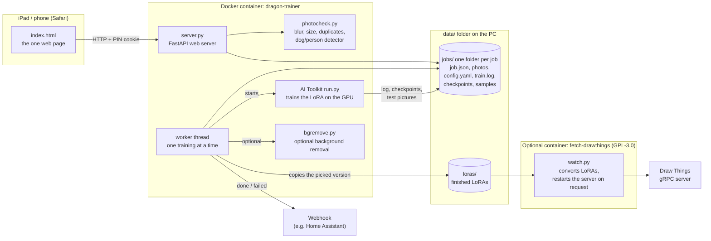

# How it works: a map of the code

This page is a tour for anyone opening the code for the first time. You don't need to know
machine learning to follow it: most of Fetch LoRA is ordinary Python that moves files around,
keeps a to-do list, and starts another program (AI Toolkit) that does the actual learning.

## The big picture



## Each file in a sentence or two

### The trainer (MIT)

| File | What it does |
|---|---|
| `app/server.py` | The heart of the project. A FastAPI web server that serves the page, checks the PIN, stores uploaded photos as "drafts", creates training jobs, runs a background **worker** thread that trains one job at a time, reads AI Toolkit's log to show progress, and delivers the finished LoRA. It's long (about 1,200 lines) but split into labelled sections; skim the `# ----` headings first. |
| `app/models.py` | The model matrix: which base models can be picked at each level (Klein 4B, Z-Image, MOSS-Image, Qwen-Image-2512), their steps, speeds, download sizes and Draw Things notes, the GPU-memory check, and each model's settings for AI Toolkit. See [MODELS.md](MODELS.md). |
| `app/photocheck.py` | Looks at each photo on the CPU: is it blurry (OpenCV Laplacian), too small, a near-duplicate (perceptual hash), and is there a dog/person in it (torchvision's small COCO detector)? Also works out the crop box around the subject. Everything "fails soft": if a check can't run, the photo just isn't flagged. |
| `app/bgremove.py` | Optional. A tiny stand-alone script that puts every photo in a folder on a white background using the BiRefNet_lite model. It runs as its own process so its GPU memory is fully released before training starts. |
| `app/static/index.html` | The whole user interface: one HTML file with its CSS and JavaScript inside. It uploads photos, shows the flags, starts trainings, and refreshes the job page every few seconds. |
| `app/static/login.html` | The PIN screen shown the first time a device visits. |
| `app/static/icon.svg`, `icon.png` | The browser tab icon and the Home Screen icon. |
| `Dockerfile` | Builds the trainer image: starts from AI Toolkit's official image, adds the web server's Python packages, bakes in the detector weights, and runs `server.py` with uvicorn. |
| `docker-compose.yml` | Tells Docker how to run the trainer: which port, which GPU, the PIN, and which PC folders to mount (`data/jobs`, `data/loras`, the model download cache). |
| `.env.example` | The settings you copy to `.env` (PIN, port, GPU, data folder). |
| `scripts/comfy_test_render.py` | A helper you run by hand to draw a test picture with a LoRA through a ComfyUI server. Not used by the app. |
| `scripts/dt_render.py` | A helper you run by hand that wraps `dts-utils` so a Draw Things gRPC server knows which LoRA it's being sent. Not used by the app. |
| `testdata/bo/CREDITS.txt` | Links to 16 public-domain photos of Bo (the Obama family dog) that were used for testing. The photos themselves aren't in the repo; download them from the links. |

### The optional Draw Things add-on (GPL-3.0)

| File | What it does |
|---|---|
| `docker-compose.drawthings.yml` | Adds the `fetch-drawthings` container when you list it in `COMPOSE_FILE`. It shares the `loras` folder with the trainer and mounts the Draw Things server's models volume (and, optionally, the Docker socket so it can restart that server). |
| `converter/Dockerfile` | Two stages: compiles Draw Things' open-source `LoRAConverter` (Swift, built with Bazel) from a pinned commit, then copies it into a small runtime image with `watch.py`. |
| `converter/build.sh` | The build commands that stage 1 of the Dockerfile runs. |
| `converter/Dockerfile.build` | A builder image definition for compiling the converter by hand. Nothing else in the repo references it. |
| `converter/watch.py` | A loop that runs every few seconds: converts any new `.safetensors` in `loras/` to Draw Things' `_lora_f16.ckpt` format, records it in `custom_lora.json`, writes a heartbeat so the page knows the add-on is alive, and handles "restart the Draw Things server" requests. |
| `converter/README.md`, `converter/LICENSE` | What the add-on does, and its GPL-3.0 license. |

## Where things live on disk

Inside the container, `/data/jobs` and `/exports` are the PC's `data/jobs` and `data/loras` folders.

```
data/
├─ jobs/
│  ├─ .auth_secret             random key used to sign the PIN cookie (made on first start)
│  ├─ .settings.json           webhook address + measured GPU speed
│  ├─ .drafts/<draft-id>/      photos picked but not started yet (deleted after 48 h)
│  │  ├─ photos/  thumbs/  meta/
│  └─ <job-id>/                one folder per training (id = 12 hex characters)
│     ├─ job.json              the job's state: name, status, steps, options, result…
│     ├─ recipe.json           which photos, their tags, and what the photo check found
│     ├─ originals/            the photos as you picked them
│     ├─ images/               the prepared photos + one caption .txt per photo (what AI Toolkit reads)
│     ├─ config.yaml           the training recipe handed to AI Toolkit
│     ├─ train.log             everything AI Toolkit printed
│     └─ output/<name>/        saved versions (*.safetensors) and samples/ (test pictures)
└─ loras/
   ├─ <name>.safetensors       the version you picked
   └─ .drawthings/             status files shared with the optional add-on
```

## The life of a training job, step by step

1. **You open the page.** `GET /` returns `index.html`. A small piece of code called *middleware*
   (`pin_gate` in `server.py`) runs before every request and checks for the PIN cookie. No cookie?
   You're sent to `/login`. Typing the right PIN (`POST /api/login`) sets a cookie that lasts a year.
2. **You pick photos.** The page asks for a new draft (`POST /api/drafts`) and uploads each photo to
   `POST /api/drafts/<id>/photos`. The server rotates it upright, shrinks it, saves a thumbnail, and
   runs `photocheck.analyze()` once to measure blur, size, a perceptual hash and detected objects.
3. **The page shows flags.** `GET /api/drafts/<id>` calls `photocheck.flags()`, which turns those
   measurements into friendly warnings like *Looks blurry* or *Almost the same as photo 3*. You remove
   photos or add tags.
4. **You press Start.** `POST /api/jobs` validates the name, copies the kept photos into a new
   `jobs/<job-id>/originals/` folder, writes `recipe.json` and `job.json` with `status: "queued"`,
   deletes the draft, and wakes the worker (`queue_event.set()`).
5. **The worker picks it up.** `worker()` is a loop on a background thread. `next_queued()` finds the
   oldest waiting job (you can reorder the line with `POST /api/jobs/<id>/move`), and `run_job()`
   marks it `running`.
6. **Photos are prepared.** `prepare_job_images()` crops around the subject (if *Zoom in* is on),
   resizes, saves `images/001.jpg, 002.jpg…`, and writes a caption next to each one, like
   `a photo of biscuit_dog, a dog` (plus your tags). If *Remove backgrounds* is on, it runs
   `bgremove.py` as a separate process. Fewer than 5 usable photos? The job fails with a friendly message.
7. **The recipe is written.** `build_config()` writes `config.yaml`: LoRA size (rank 32), learning
   rate, number of steps (from `plan_steps()`), how often to save a version (`save_every()`, about 5 per
   run), and three test prompts (`sample_prompts()`).
8. **AI Toolkit trains.** `run_job()` starts `python run.py config.yaml` inside AI Toolkit's folder with
   `subprocess.Popen`, sending all its output to `train.log`, then waits. The first run ever downloads
   the base model (~16 GB) into the Hugging Face cache.
9. **The page shows progress.** While it trains, the page calls `GET /api/jobs/<id>` every 8 seconds.
   `public()` builds the answer: `progress()` reads the end of `train.log` with regular expressions to
   find the current step and loss, `measure_speed()` works out seconds per step (and remembers it for
   future estimates), and `samples()` lists the test pictures drawn so far.
10. **Training ends.** If AI Toolkit exits with code 0, `deliver()` copies the chosen version (by default
    the last one) to `data/loras/<name>.safetensors` and any extra delivery folders. The job becomes
    `done`, and `notify()` sends the optional webhook. If it crashed, the job becomes `failed` with a hint
    (for example "the GPU ran out of memory"), and **Resume** puts it back in line; AI Toolkit continues
    from its newest saved version.
11. **You pick a version.** `POST /api/jobs/<id>/choose` switches which saved step is "the" LoRA and
    re-delivers it. **Download** is `GET /api/jobs/<id>/files/lora/…`.
12. **Optional: Send to Draw Things.** `POST /api/jobs/<id>/drawthings` drops a request file in
    `loras/.drawthings/`. The add-on's `watch.py` has already converted the LoRA; it sees the request,
    restarts the Draw Things server so it re-reads its LoRA list, and writes a result file the page reads.
13. **Train again.** `POST /api/jobs/<id>/again` loads the old job's photos, tags and settings into a
    new draft so you can tweak and start over.

If the PC or container restarts mid-training, `startup()` marks running jobs as `interrupted` so you can
press **Resume**.

## Good places to start reading

- `plan_steps()`, `save_every()`, `parse_tags()` and `merge_caption()` in `server.py`: short, pure
  functions (same input, same output, no files or GPU), easy to understand and to test.
- `photocheck.flags()`: plain `if` statements that turn numbers into warnings.
- `build_config()`: the whole training recipe as one Python dictionary.
- `run_job()` and `worker()`: how the waiting line and the subprocess fit together.
